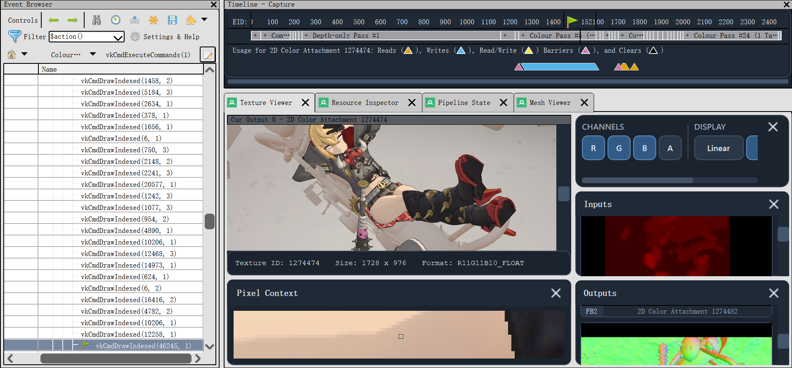

# ZZZ RenderDoc

## Branch And Version Policy

`HSR` and `ZZZ` are separate long-lived development branches; `main` remains
the baseline. This branch keeps the ZZZ MuMu implementation originally
developed for ZZZ 3.0; later clients require separate validation. Client
versions belong in configuration and evidence, not new development branches.
Former branch tips are available as `archive/branches/<former-name>` tags.
Existing release tags and capture variant markers remain unchanged.

This branch is a RenderDoc build dedicated to capturing and replaying
Zenless Zone Zero (ZZZ) running inside MuMu. It is not a ZZZ asset extractor;
its output is the `.zzzrdc` capture used for later ZZZ frame, resource and
rendering analysis.



## What Changed

- Keeps the MuMu EGL hooks and offscreen Vulkan-submit path required to capture
  the real ZZZ rendering instead of the empty host shell.
- Uses the `.zzzrdc` extension and embeds the technical `ZZZ` variant marker
  for compatibility with matching captures.
- Rejects captures without the matching embedded variant marker before replay.
- Updates the RenderDoc UI and command-line tools to open and save `.zzzrdc`
  files.
- Adds MuMu capture diagnostics and filters utility/crash-reporting child
  processes while preserving injection into the rendering processes.
- Updates the Texture Viewer, Timeline and panel layout with the shared custom
  UI styling.

## Build Requirements

Build the Windows development configuration and make sure these files exist in
`x64\Development`:

- `renderdoccmd.exe`
- `renderdoc.dll`
- `renderdoc.json`

MuMu must also be installed and contain `nx_main\MuMuNxMain.exe` and
`nx_main\mumu-cli.exe`.

## Capture ZZZ

1. Double-click `tools\Start-ZZZ-MuMuRenderDocCapture.bat`.
2. In the dialog, select `MuMuNxMain.exe`.
3. Select this build's `x64\Development\renderdoccmd.exe`.
4. Click `Start capture` and wait for the launcher to report that injection is
   ready.
5. Enter the ZZZ 3D scene and press the normal RenderDoc capture hotkey, such
   as `F12` or `PrtScr`.

The launcher requests administrator privileges when required, restarts MuMu,
registers the selected ZZZ Vulkan layer, and starts the MuMu host through
RenderDoc. It enables child-process hooking and offscreen-submit capture
options.

Captures are written by default to:

`D:\Unpack_Workspace\RenderDocTests\mumu-host\mumu-host_zzz_<frame>.zzzrdc`

The selected paths are remembered for the current Windows user at
`%LOCALAPPDATA%\ZZZ-RenderDoc\launcher-settings.json`.

The launcher also accepts a directory instead of an EXE. For unattended use:

```powershell
PowerShell.exe -NoProfile -ExecutionPolicy Bypass -File `
  .\tools\Start-ZZZ-MuMuRenderDocCapture.ps1 `
  -NoGui `
  -MuMuRoot 'D:\Unpack_Workspace\Games_MUMU\MuMuPlayerGlobal\nx_main\MuMuNxMain.exe' `
  -RenderDocBin 'D:\Unpack_Workspace\Base_RenderDoc_ZZZ\my-renderdoc\x64\Development\renderdoccmd.exe'
```

Use the ZZZ build to open `.zzzrdc` files. Renaming a capture does not change
its embedded variant marker; captures must be opened with the matching build.

## Mesh Preview Stability

The Vulkan `VK_ERROR_DEVICE_LOST` crash that could occur when opening Mesh
Preview or switching DRAW events has been fixed in the current build.

For Vulkan captures, the unstable post-output replay path is intentionally
disabled in Mesh Preview. This includes replaying vertex-shader/geometry-shader
post-VS outputs and task/mesh-shader post outputs. The normal input vertex data
path, texture and output viewing, pipeline inspection, and DRAW/event
navigation remain available.

This keeps the capture analysis workflow usable while avoiding the replay
operation that could trigger a GPU watchdog reset on the affected driver and
capture combination.

## Known Limitations

Vulkan post-output mesh preview is not currently available because that replay
path is disabled for stability. Captures should still be opened with the
matching build and important captures should be backed up before analysis.
