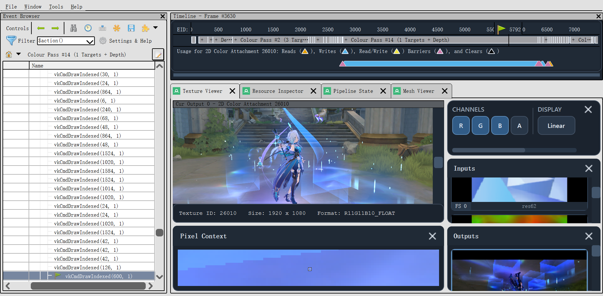

# HSR-4.6-MUMU RenderDoc

The active client is HSR 4.6.0. Earlier HSR 4.5 captures remain offline regression
fixtures. Capturing and replaying the new client must be validated separately;
the branch name alone does not certify compatibility.

This branch is a RenderDoc build dedicated to capturing and replaying
Honkai: Star Rail (HSR) running inside MuMu. It is not the HSR asset extractor;
its output is the `.srrdc` capture used for later HSR resource and shader
analysis.



## What Changed

- Keeps EGL hooks enabled for MuMu's host EGL/GLES bridge, which is required to
  capture the real HSR rendering instead of an empty host shell.
- Uses the `.srrdc` extension and embeds the technical `HSR` variant marker for
  compatibility with existing captures.
- Rejects captures without the matching embedded variant marker before replay.
- Updates the RenderDoc UI and command-line tools to open and save `.srrdc`
  files.
- Adds MuMu capture diagnostics and avoids null remote-device controllers during
  device enumeration.

## Build Requirements

Build the Windows development configuration and make sure these files exist in
`x64\Development`:

- `renderdoccmd.exe`
- `renderdoc.dll`
- `renderdoc.json`

MuMu must also be installed and contain `nx_main\MuMuNxMain.exe` and
`nx_main\mumu-cli.exe`.

## Capture HSR

1. Double-click `tools\Start-HSR-MuMuRenderDocCapture.bat`.
2. In the dialog, select `MuMuNxMain.exe`.
3. Select this build's `x64\Development\renderdoccmd.exe`.
4. Click `Start capture` and wait for the launcher to report that injection is
   ready.
5. Enter the HSR 3D scene and press the normal RenderDoc capture hotkey, such as
   `F12` or `PrtScr`.

The launcher requests administrator privileges when required, restarts MuMu,
registers the selected HSR Vulkan layer, and starts the MuMu host through
RenderDoc. It enables child-process hooking and reference-all-resources capture
options.

Captures are written by default to:

`D:\Unpack_Workspace\RenderDocTests\mumu-host\mumu-host_hsr_<frame>.srrdc`

The selected paths are remembered for the current Windows user at
`%LOCALAPPDATA%\HSR-RenderDoc\launcher-settings.json`.

The launcher also accepts a directory instead of an EXE. For unattended use:

```powershell
PowerShell.exe -NoProfile -ExecutionPolicy Bypass -File `
  .\tools\Start-HSR-MuMuRenderDocCapture.ps1 `
  -NoGui `
  -MuMuRoot 'D:\Unpack_Workspace\Games_MUMU\MuMuPlayerGlobal\nx_main\MuMuNxMain.exe' `
  -RenderDocBin 'D:\Unpack_Workspace\Base_RenderDoc\my-renderdoc\x64\Development\renderdoccmd.exe'
```

Use the HSR build to open `.srrdc` files. Renaming a capture does not change its
embedded variant marker; captures must be opened with the matching build.

## Shader Export

The command-line tool can export deduplicated shader records, reflection,
pipeline bindings, vertex inputs and per-event metadata. It does not emit a
fake Unity shader by default:

```powershell
renderdoccmd.exe shader-export capture.srrdc `
  --output ShaderExports\frame `
  --event 436 `
  --reconstruct `
  --spirv-cross path\to\spirv-cross.exe `
  --export-resources
```

When the capture contains SPIR-V, `--reconstruct` produces real
`*.reconstructed.hlsl` files through the explicitly supplied SPIRV-Cross
binary. `--export-resources` additionally saves the textures bound at the
selected events as DDS and bounded buffer ranges as `.bin` snapshots. The
manifest `capture.json` records the exact shader/resource identity, snapshot
paths and a reconstruction status for every unique shader:

- `Ready`: HLSL was reconstructed and no external shader resource was reflected.
- `NeedsBinding`: HLSL was reconstructed, but textures, buffers or material
  values still need to be exported and bound in Unity.
- `NeedsReview`: reconstruction was not requested or could not be validated.
- `Unsupported`: raw shader bytes or backend disassembly were unavailable.

The legacy magenta ShaderLab files are opt-in only through
`--emit-placeholder-templates` and must not be treated as reconstructed assets.

## Mesh Preview Stability

The Vulkan `VK_ERROR_DEVICE_LOST` crash that could occur when opening Mesh
Preview or switching DRAW events has been fixed in the current build.

For Vulkan captures, the unstable post-output replay path is intentionally
disabled in Mesh Preview. This includes replaying vertex-shader/geometry-shader
post-VS outputs and task/mesh-shader post outputs. The normal input vertex data
path, texture and output viewing, pipeline inspection, and DRAW/event
navigation remain available.

This keeps the capture analysis workflow usable while avoiding the replay
operation that could trigger a GPU watchdog reset on the affected driver and
capture combination.

## Known Limitations

Vulkan post-output mesh preview is not currently available because that replay
path is disabled for stability. Captures should still be opened with the
matching build and important captures should be backed up before analysis.
